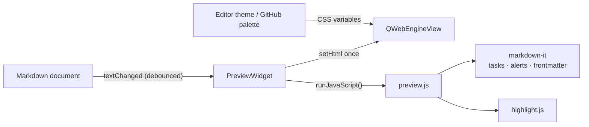

# Contributing

Issues and PRs are welcome. File an issue through the
[chooser](https://github.com/obook/katemark/issues/new/choose), or open a
PR against the default branch. PR titles follow
[Conventional Commits](https://www.conventionalcommits.org): `type(scope): summary`.

## AI contributions

AI-assisted work is welcome. Say who directed the change and which of its claims you verified.
Use the issue forms and the PR template, and tick your AI-involvement level. You answer for
the whole diff.

## Building and running

The build dependencies and the three ways to install are in the
[README](../README.md#build-from-source). To try a change, run a Kate that loads the freshly
built plugin without installing it:

```bash
cmake -B build -S . -DCMAKE_BUILD_TYPE=Debug
cmake --build build -j"$(nproc)"
QT_PLUGIN_PATH="$PWD/build/bin" kate some-file.md
```

On Windows the plugin has to match the ABI of Kate's own build, and Kate ships no headers, so
it is built with [KDE Craft](https://community.kde.org/Craft) and MSVC 2022.
`.github/workflows/windows.yml` is the working recipe.

## Tests

The tests keep their configuration out of your own Kate settings:

```bash
cmake -B build -S . -DCMAKE_BUILD_TYPE=RelWithDebInfo -DBUILD_TESTING=ON
cmake --build build
ctest --test-dir build --output-on-failure
```

On a desktop they open windows that take the keyboard: do not type while they run, or run them
without a display, `QT_QPA_PLATFORM=offscreen ctest --test-dir build`. The tests that read a
PDF back need `pdftotext` (package `poppler-utils`, `poppler` on Arch) and are skipped without
it.

`./build.sh` runs them too, before it makes the Debian package.

## Translations

One file per language: `po/<language>/katemark.po`. After changing a string in the sources, run
`bash po/update.sh` from the repository root: it refreshes `po/katemark.pot` and merges it into
every translation.

## Releases

A tag `v<version>` that matches `project(VERSION)` in `CMakeLists.txt` and `Version` in
`src/katemark.json` starts three workflows: `release.yml` creates the GitHub release, `deb.yml`
attaches the Debian packages for KDE neon and Ubuntu 26.04, `windows.yml` attaches the Windows
zip.

## Source layout

| Path | Content |
|---|---|
| `src/plugin.*` | Plugin entry point and settings page registration |
| `src/pluginview.*` | Per-window actions, toolbar and menu wiring, the preview tool view |
| `src/pluginviewedit.cpp` | The Markdown editing actions of the Tools menu |
| `src/markdownedit.*`, `src/markdowntable.cpp` | What those actions do to the text: markers, headings, links, tables |
| `src/previewwidget.*` | The preview widget: the bar, the web view, attaching a document, rendering |
| `src/previewload.cpp` | Building the HTML page and loading it |
| `src/previewtheme.*` | GitHub palettes and the colors derived from the editor theme |
| `src/previewpage.h` | The request filter and the link handling of the web page |
| `src/previewscroll.cpp` | Scroll sync with the editor |
| `src/previewexport.cpp` | PDF and HTML export |
| `src/previewinput.cpp` | Keys and mouse buttons handed back to Kate |
| `src/previewutil.h` | Small shared helpers |
| `src/imagepaste.*` | Pasting a clipboard image into a Markdown document |
| `src/configpage.*` | The settings page |
| `src/settings.*` | Persisted settings |
| `data/js/preview.js` | The page's rendering and the functions the plugin calls |
| `data/js/preview/` | One file per concern: shared helpers, GitHub task lists and front matter, callouts, CodiMD, Obsidian, MkDocs, math, Mermaid, scroll sync, blocked pictures |
| `data/` | The other bundled HTML, CSS, JS and the qrc |
| `tests/` | Five test programs; the four that need a preview share `testhelpers.h` |

A comment that starts with `ponytail:` marks a shortcut taken on purpose: it names the limit
and what to do when that limit is reached.

## How it works

The preview is a `QWebEngineView` inside a tool view created through
`KTextEditor::MainWindow::createToolView`. The page is one HTML document whose assets are
inlined or loaded from the plugin's own resources, so nothing loads over the network. Its
content security policy lets only the plugin's scripts run: a document's raw HTML is shown,
its scripts are not.



- Layout and typography come from `github-markdown-css`. Its color values are stripped out so
  that the plugin drives them from CSS custom properties.
- [markdown-it](https://github.com/markdown-it/markdown-it) parses the Markdown. Bundled
  plugins add task-list checkboxes and GitHub alerts, and a leading YAML front matter is parsed
  with [js-yaml](https://github.com/nodeca/js-yaml) into a metadata table.
- Code highlighting uses [highlight.js](https://github.com/highlightjs/highlight.js). In GitHub
  style it uses the github and github-dark themes. In theme-matched style the token colors are
  generated at runtime from `KTextEditor::View::theme()`, so they line up with the editor.

Code highlighting is close to GitHub's without being identical, because GitHub uses its own
server-side highlighter. [starry-night](https://github.com/wooorm/starry-night) is a faithful
port of it and could replace highlight.js.
